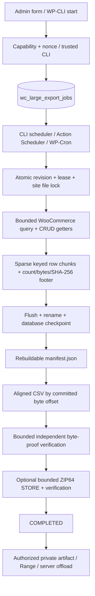

# Kiến trúc Large Product Export

## Phạm vi và điểm tích hợp

Subsystem nằm trong `wp-content/plugins/woocommerce/includes/export/large-export/`, namespace `Automattic\WooCommerce\Internal\LargeExport`. Thêm bootstrap opt-in vào `woocommerce.php` và một hook hỗ trợ đọc không ghi ở variation data store; không thay public API của các exporter cũ, importer, cart, checkout, permalink hoặc frontend. Mặc định tắt `WC_LARGE_PRODUCT_EXPORT`; khi bật, Compatibility Mode là mặc định của job. Keyset là lựa chọn chủ động, cần kiểm chứng với extensions của site.



## Các class

| File | Trách nhiệm |
|---|---|
| `class-bootstrap.php` | Bật subsystem có điều kiện, đăng ký integration và hook WP-CLI thật `after_wp_load`. |
| `class-store.php` | Schema version 1, durable jobs, revision compare-and-swap, lease token, chuyển trạng thái, retry và retention. |
| `class-engine.php` | Validate cấu hình, freeze watermark khi tạo job, chạy các đơn vị hữu hạn, điều khiển phase và adaptive batch. |
| `class-reader.php` | WooCommerce query/CRUD/row hooks, keyset CPT có watermark, variations có cursor riêng, prefetch metadata và schema động. |
| `class-files.php` | Vùng lưu riêng, single-writer lock, chunk checksums, recovery, CSV finalizer, segment verifier và ZIP64. |
| `class-integration.php` | Admin UI/AJAX, queue group riêng, sweeper, authorization và download. |
| `class-command.php` | Start/status/run/pause/resume/cancel/retry/verify/cleanup bằng WP-CLI. |

## Dữ liệu bền vững và trạng thái

Bảng site-local `{prefix}wc_large_export_jobs`: UUID, owner, request-key unique, status/resume-status, JSON config/checkpoint/logs, revision, lease token/expiry/heartbeat, available/created/started/updated/completed timestamps, attempts và safe error. JSON có schema version; config ghi types, statuses, category slugs, tối đa 2.000 selected IDs, columns, metadata, spreadsheet/BOM/delimiter, mode/format, live consistency và source watermark. Không lưu một triệu ID trong options/transients hoặc job row. Danh sách parent đang mở rộng không vượt batch hiện tại.

Các trạng thái: `pending`, `queued`, `running`, `pausing`, `paused`, `finalizing`, `verifying`, `completed`, `failed`, `cancelling`, `cancelled`, `expired`. Job mới được tạo trực tiếp ở `queued`; `pending` được hỗ trợ trong queue. Operator dùng các transition được kiểm tra; pause lưu phase để resume cả finalize/verify. Cancel chờ unit hiện tại và xóa tối đa 256 file mỗi lượt. Không thể cancel một artifact đã completed; retention xử lý artifact đó. Log chuyển trạng thái giữ tối đa 20 sự kiện, không ghi product row, credential hoặc exception tùy ý từ plugin.

Claim là atomic compare-and-swap dựa trên revision/lease. Lease 300 giây, heartbeat sau mỗi unit, retry tối đa 5 lần với backoff tăng dần từ 15 giây. Lease bỏ dở do fatal/kill cũng tính vào retry budget khi được claim lại. Một khóa `flock()` trên site giới hạn **một writer toàn site**, mạnh hơn một writer/job. Yêu cầu mọi worker dùng chung private filesystem có `flock` và atomic rename hoạt động đúng. Không hỗ trợ worker nhiều node dùng đĩa local riêng.

Retention atomically chuyển sang `expired` trước khi xóa file; owner retry thắng revision race thì không xóa chunk. `resume_status=purging/purged` là marker nội bộ để tiếp tục bounded purge và tránh job đã xóa hết làm nghẽn queue. Có regression 257 files và interleaving retry/expiry.

## Query, compatibility và dữ liệu đang thay đổi

Compatibility Mode dùng WooCommerce query có paging và bounded limit; không gọi `COUNT` từng batch. Keyset thêm `ID > cursor AND ID <= max_id` vào đúng query có marker UUID và ép page 1; vẫn chạy `wc_get_products()` và CRUD row transformer gốc. Thứ tự không tương thích trước khi xuất có thể chuyển Compatibility; thứ tự/query thay đổi giữa job hoặc query override không thể chứng minh bounded thì fail an toàn, yêu cầu export mới/legacy. Custom data store chuyển Compatibility và không giả định watermark của `wp_posts` là snapshot cho store đó.

Tối ưu taxonomy chỉ loại bỏ đúng nhánh OR đã chứng minh là hằng đúng khi selection bao trùm mọi type term thực tế. Tối ưu metadata chỉ áp dụng với CPT/native callbacks đã audit; callback extension chưa biết giữ cách hydrate gốc. Mỗi lần prefetch tối đa 500 ID dù batch sản phẩm có thể tới 2.000. Metadata có `meta_id`, WordPress meta cache và WC raw-meta cache được prime trước hydration; `filter_raw_meta_data()` và hook tùy biến giá trị/dòng vẫn chạy. Không thêm index, không đổi MySQL optimizer toàn server, không dùng query hint chưa chứng minh hiệu quả.

Khi include/category kích hoạt parent expansion, mỗi parent dùng cursor variation riêng và query có limit; không dùng `limit=-1`. Child đã được main query chọn sẽ không được ghi lần thứ hai. Mặc định child statuses theo đúng `WC_Product_Query` của legacy; filter status mới được chỉ định thì được tôn trọng. Thứ tự main batch và parent expansion được checkpoint cùng nhau. Semantics intentionally deduplicate parent+selected-child, trong khi legacy có thể ghi child hai lần.

`max_id` được freeze lúc tạo job CPT, không đợi worker. **Đây là best-effort live export**: chỉnh sửa/xóa/thay filter eligibility trong khi chạy có thể thay đổi output; Compatibility/OFFSET đặc biệt không bảo đảm snapshot khi tập kết quả dịch chuyển. Muốn snapshot nhất quán phải dùng database clone/backup riêng cho worker, không giữ transaction production dài. Snapshot transaction đa worker chưa được triển khai.

Hook biến đổi nguyên chuỗi CSV theo batch `woocommerce_product_export_rows` bị từ chối ngay khi tạo job, kèm hướng dẫn dùng legacy; không âm thầm bỏ qua hook. Row hooks, column names/default columns/custom column values, metadata skip/value hooks và export query hooks tiếp tục sử dụng source WooCommerce. Không thể chứng minh tương thích với mọi extension chỉ bằng native fixture.

WC variation `read()` có thể tự UPDATE title. Worker bọc toàn unit trong hook read-only có scope, tháo trong `finally`; vẫn tính tên như WooCommerce cho CSV nhưng bỏ title repair trong DB. Capability marker được kiểm tra trước tạo job và trước đọc để fail closed nếu update làm mất patch. Đường đọc thông thường/legacy giữ mặc định cũ. Custom columns đọc trực tiếp `post_title` có thể thấy title cũ khi dữ liệu không đồng bộ, khác với tên tính toán từ CRUD. Hook extension có side effect riêng cần test hoặc clone/read-only DB account. Chỉ gọi Reader sản xuất qua Engine để có scope bảo vệ.

## File protocol và schema động

```
PRIVATE_ROOT/wc-products-SITE_HASH/JOB_UUID/
  manifest.json
  chunk-00000000.rows
  chunk-00000001.rows
  products.partial -> products.csv
  proof.partial
  ready.json
  products.zip.partial -> products.zip   # tùy chọn
  zip-proof.partial / ready-zip.json     # tùy chọn
```

Chunk chứa từng sparse row dưới dạng JSON UTF-8 có marker và footer số record/byte/SHA-256. Worker ghi `.tmp`, kiểm tra mọi write, flush/fsync khi PHP hỗ trợ, đóng và rename rồi mới commit checkpoint DB. DB là nguồn sự thật; `manifest.json` là bản mirror có thể dựng lại, không phải nơi chứa triệu ID. Crash sau rename trước checkpoint: chunk tại index chưa commit được bỏ và dựng lại, không append lặp. Không sửa lại chunk đã commit.

Schema là hợp của column keys theo thứ tự khám phá đã commit. Finalizer đọc một chunk mỗi unit, căn mọi dòng theo schema cuối và ghi CSV tăng dần. Offset CSV/proof/row count được checkpoint; retry cắt phần append chưa commit. Cột metadata/attributes/downloads xuất hiện cuối job vẫn có chỗ trống đúng trên các dòng đầu. Giới hạn 10.000 cột và 32 MiB cho một JSON-encoded row; vượt giới hạn thì báo lỗi thay vì bỏ dòng. Bộ nhớ phụ thuộc batch/schema/largest row, không phụ thuộc tổng record.

CSV dùng enclosure `"`, double-quote escaping, escape byte rỗng, LF, delimiter kế thừa WooCommerce, BOM tùy chọn. NULL/empty cell và kiểu custom meta tuân hành vi transformer legacy. Spreadsheet mode dùng formula protection gốc; import mode giữ giá trị gốc và phải được chọn chủ động. Numeric string giữ byte ban đầu, nhưng ứng dụng spreadsheet vẫn có thể tự suy luận kiểu khi mở CSV.

Verifier đọc tối đa các segment giới hạn trong một unit, đối chiếu proof do writer tạo và chỉ rename/publish sau khi toàn byte stream được kiểm chứng. PHP 8+ lưu HashContext SHA-256 có version PHP trong checkpoint; đổi runtime thì verify lại từ đầu. PHP 7.4 dùng validator `sha256-segments-v1`, **không gọi đó là SHA-256 của toàn file**; CLI verify tính lại segments, không so checksum đã lưu với chính nó.

ZIP dùng ZIP64 STORE để checkpoint được từng 8 MiB, có CRC32 và proof SHA-256 độc lập; không nạp cả CSV vào RAM hoặc phụ thuộc `ZipArchive::close()` chạy một lượt lâu. Cần PHP 8+ để serialize CRC context. STORE không nén: phải dự trù dung lượng CSV + staging rows + archive. ZIP64 được kiểm tra bằng parser độc lập ở quy mô fixture, chưa kiểm chứng archive trên 4 GiB.

Local CRC/sizes để zero khi bit data-descriptor bật; final sizes/CRC nằm trong descriptor/central directory. Đã sửa local-header mixed known/unknown sizes bị libzip 1.7.1 CHECKCONS từ chối và giữ strict validation. Runtime PHP 8.0–8.4 đã qua parser/replay; đây chưa phải phép thử file trên 4 GiB.

## Resource budget và delivery

Batch mặc định initial 500, min 100, max 2.000; filters cấu hình giới hạn và throttle. Keyset giảm batch khi unit/query/write chậm hoặc memory >70% PHP limit, chỉ tăng trong giới hạn khi ổn định. Compatibility giữ batch cố định để paging không đổi offset; checkpoint lưu `page_limit` và từ chối thay đổi limit qua hook giữa các batch. Reader kiểm tra lại ranh giới native CPT/custom data store mỗi batch và dừng nếu loại store đổi. Unit có thể vượt time budget nếu một query/I/O bị treo; time budget không phải cơ chế ngắt MySQL cưỡng bức. Không tự tăng memory/time limit hoặc concurrency.

Directory phải tồn tại, canonical, không symlink, nằm ngoài WordPress/uploads/document root, PHP 64-bit. Kiểm tra free space với reserve 64 MiB trước ghi; chưa có ước lượng dung lượng cuối đáng tin cậy cho mọi filter/custom column. Các chunks được giữ tới retention; phải dự trù nhiều bản vật lý khi finalize/ZIP. Đây là giới hạn vận hành còn cần cải thiện.

Download luôn kiểm tra capability `edit_products` + `export`, owner hoặc site admin có `manage_options`, nonce và DB completion/checksum/byte count đối chiếu readiness marker. `manage_woocommerce` riêng không cho shop manager tải job của administrator. Filename/đường dẫn từ request không được dùng. Tắt output buffering/compression cho byte-exact transfer, GET/HEAD, single Range 200/206/416, ETag/If-Range, private no-store. File không bị xóa ngay sau một lần download. Fallback stream vẫn giữ một PHP worker trong thời gian truyền; X-Accel/X-Sendfile cần hạ tầng cấu hình và kiểm thử riêng.

Process-kill recovery đã có test thật. Khả năng chịu power loss/reboot, fsync directory metadata, NFS/distributed locking và disk fault thật chưa được kiểm chứng; không được suy diễn từ test `proc_terminate()`.
