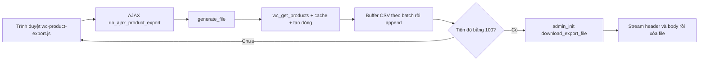

# Audit của trình xuất CSV sản phẩm

Bản gốc để đối chiếu là Git `c8e7a752`, WordPress 6.8.2 và WooCommerce 10.3.5. WooCommerce yêu cầu PHP 7.4 trở lên. Máy phát triển chạy PHP CLI 8.4.4 x64. Bản sao source đã lưu trong thư mục tạm của máy trước khi sửa. Phiên bản cơ sở dữ liệu staging và baseline đo được được ghi trong báo cáo benchmark.

| Câu hỏi | Bằng chứng trong source hiện tại |
|---|---|
| File được nạp vào RAM ở đâu? | `WC_CSV_Batch_Exporter::get_file()` đọc cả body. `export()` gọi phương thức này và nối header khi lớp con ghi đè API xuất chuỗi. Nhánh mặc định hiện đã dùng `stream_copy_to_stream()`. `generate_file()` vẫn gọi `get_file()` ở batch đầu sau khi thử xóa file, nên việc xóa thất bại có thể khiến file cũ được đọc. |
| OFFSET và COUNT | `WC_Product_CSV_Exporter::prepare_data_to_export()` mặc định query phân trang và tính tổng ở batch đầu. Sau đó reuse transient. Cache miss, cursor thiếu hoặc thứ tự/offset tùy biến có thể trở lại phân trang OFFSET. Cache key chứa filename và các tham số truy vấn. |
| Truy vấn liên quan | Bản vá hiện tại đã prime ảnh, sản phẩm liên kết và tác giả theo batch. Khi lọc theo ID hoặc danh mục, mỗi parent variable vẫn phát sinh query riêng cho toàn bộ variation với `limit = -1`. Getter, taxonomy và plugin có thể phát sinh query bổ sung. |
| Request và trình duyệt | JS gửi từng batch, truyền cursor và các cột đã tìm thấy. Mỗi batch giữ một PHP worker trong lúc query, chuyển đổi và ghi. Đóng tab làm ngừng chuỗi request. Download mặc định vẫn dùng PHP worker và xóa file sau khi stream. |
| Ghi, retry và race | `write_csv_data()` append theo filename và không kiểm tra số byte từ `fwrite()`. Cùng filename hoặc gửi lại cùng bước có thể ghi trùng hoặc đụng file. Không có định danh job bền vững và checkpoint độc lập. |
| Tiến độ | `get_total_exported()` cộng số batch ước tính với số dòng thực tế, còn total lấy từ truy vấn chính. Variation mở rộng có thể đẩy tiến độ vượt 100, làm điều kiện so sánh `100 ===` phụ thuộc dữ liệu. File lỗi ghi cũng không được dùng để quyết định thành công. |
| Cột động | JS tích lũy header qua từng batch. Body đã ghi trước khi các cột mới xuất hiện, nên dòng cũ không được căn lại theo schema cuối. |
| Quyền và file | `WC_Admin_Exporters` kiểm tra `edit_products` và `export`, AJAX dùng nonce `wc-product-export`, download dùng nonce `product-csv`. Đường dẫn legacy lấy từ uploads và filename đã làm sạch. |

`error_log` và `php-error.log` trong repo không cung cấp dòng 503, timeout, cạn RAM hoặc stack trace gắn với exporter. Chưa thể quy lỗi 503 cho batch, download, PHP-FPM, proxy, DB hoặc I/O. Cần đối chiếu timestamp và URL/action giữa access log, error log của web/proxy, PHP slow log, DB slow log và thông số ổ đĩa để kết luận sự cố đã xảy ra trên máy nguồn.

## Bằng chứng bổ sung từ staging local, ngày 21/11/2026

Môi trường tách biệt: `WC_EXPORT_STAGE=true`, database `wc_export_stage`, prefix `wcstage_`, MariaDB 11.5.2 trên loopback, PHP CLI 8.4.4 x64, giới hạn worker 256 MiB. Fixture đã có 1.000.000 sản phẩm/biến thể; không seed hoặc benchmark vào database của bản sao website gốc. Test bootstrap từ chối chạy khi tên database, prefix, host, environment hoặc cờ fixture không khớp.

- Legacy của **repository hiện tại**, không phải upstream WooCommerce chưa sửa: 1.000 dòng mất 51,526 giây; 10.000 dòng mất 520,211 giây. CSV được parse bằng `fgetcsv()`, đối chiếu ID, SKU, tên Unicode và bitmap ID; không dùng newline làm số record. Xem `evidence/legacy-1000.jsonl` và `evidence/legacy-10000.jsonl`.
- Profile 100 sản phẩm cho thấy một query chính mất khoảng 5 giây và 100 query riêng của `WC_Data_Store_WP::read_meta()`. WordPress post-meta cache không chứa `meta_id`, nên prime cache của WordPress chưa đủ cho WooCommerce CRUD. Xem `evidence/profile-explain.jsonl`.
- `EXPLAIN` cho thấy phần loại sản phẩm của WooCommerce có subquery `MATERIALIZED`. Thêm `STRAIGHT_JOIN`/`FORCE INDEX(PRIMARY)` trong thí nghiệm không giải quyết được; **không đưa các hint đó vào engine**. Refresh statistics chỉ được chạy trên fixture; cũng không loại bỏ được kế hoạch materialization này. Không thêm index và không đổi optimizer settings toàn server.
- Với 2.000 ID, hai query metadata còn chuyển sang `ALL` + `Using filesort`, mỗi query quét ước tính 5.011.007 hàng và mất khoảng 26 giây. Đây là bằng chứng cho việc phải giới hạn kích thước từng truy vấn prefetch, độc lập với batch sản phẩm. Xem `evidence/profile-2000.jsonl`.
- Đường keyset mới chỉ bỏ đúng predicate loại sản phẩm có thể chứng minh là hằng đúng: đã chọn mọi `product_type` thực sự tồn tại, gồm nhánh không có type. Predicate khác, taxonomy hooks của extension và data store tùy biến được giữ nguyên. Prefetch WordPress/WooCommerce metadata theo nhóm tối đa 500 ID trước hydration; giữ `filter_raw_meta_data()` và row hooks.
- Sau sửa, mẫu 2.000 sản phẩm còn khoảng 0,94 giây và 9 query (`evidence/profile-2000-optimized.jsonl`). Đây là số đo mẫu, không phải kết luận cho mọi website hoặc plugin.
- Test HTTP thật phát hiện WordPress `wp_magic_quotes()` cũng escape `$_SERVER`: ETag trong `If-Range` bị thêm dấu `\\`, khiến server trả 200 thay vì 206. Đã thêm `wp_unslash()` trước so sánh validator và chạy lại test endpoint có đăng nhập.
- Audit thêm `WC_Product_Variation_Data_Store_CPT::read()` phát hiện UPDATE `post_title` + `clean_post_cache()` ngay trong getter khi title không khớp parent. Đây là nguồn query ghi ở vùng fixture chưa hydrate; không thể gọi CRUD là read-only mặc định. Đã thêm core hook/capability marker và scope worker; kiểm tra raw title/timestamps/meta và SQL writes. Legacy ngoài scope giữ hành vi cũ. Lượt 500k trước sửa nằm trong `diagnostic-before-readonly-500000.jsonl`, không phải acceptance read-only.
- Benchmark cuối kiểm tra chính xác ID/type/SKU/tên tính toán/description của từng record, checksum độc lập với checkpoint và bắt buộc `product_write_queries=0`. Extension đọc trực tiếp source/meta vẫn cần parity trên site thật.

Các lượt benchmark dài bị dừng chủ động khi phát hiện query plan xấu hoặc side effect ghi title. Các file bằng chứng rỗng/dở không phải kết quả hoàn thành và không được dùng để suy diễn thời gian ở quy mô lớn. Báo cáo benchmark phân biệt lượt điều tra với acceptance sau sửa read-only.

## Điều tra 503 còn cần trên hạ tầng gây lỗi

Cần timestamp, URL/action và request ID của sự cố; access/error log Nginx/Apache/CDN, PHP-FPM error/slow log, `pm.max_children`, `request_terminate_timeout`, PHP memory/time limits, MySQL slow log/connection counters, disk/inode/I/O và OOM-killer log cùng thời điểm. Phân biệt AJAX batch, status và download. Không có các log đó trong môi trường local này, nên **nguyên nhân của 503 đã xảy ra trên máy nguồn vẫn chưa được xác nhận**. Query chậm, giữ FPM worker và đọc toàn file ở API legacy là rủi ro có bằng chứng trong source; chúng không tự chứng minh nguyên nhân một response 503 cụ thể.
